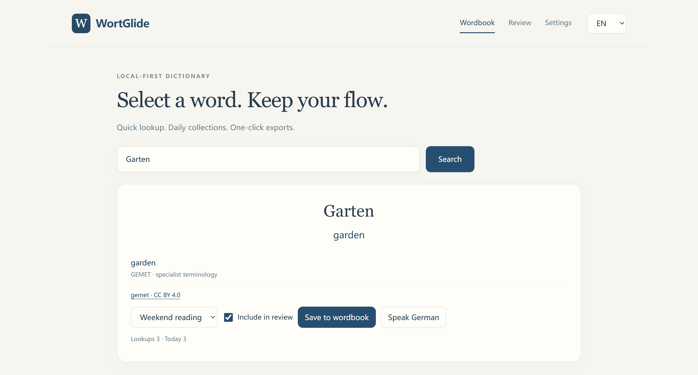
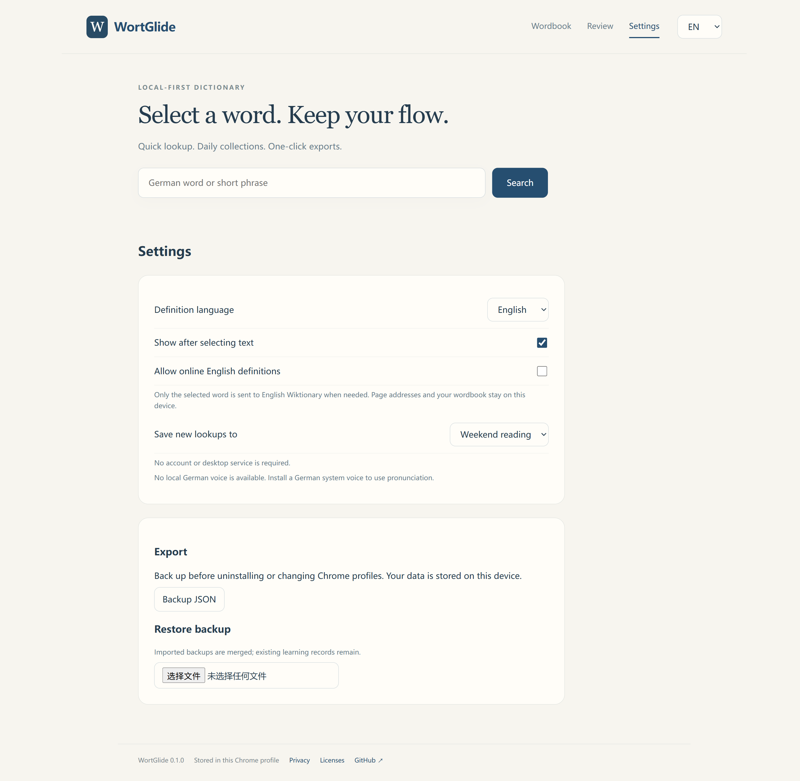
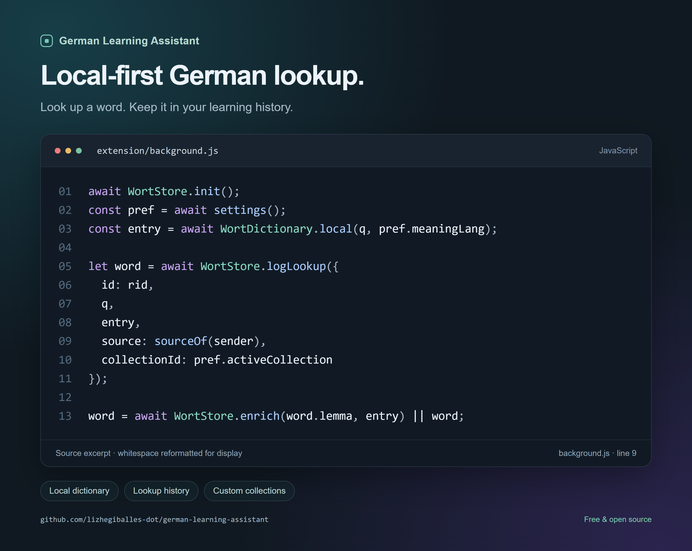

<div align="center">

# German Learning Assistant

**Look up German words without leaving your reading.**

A free, open-source Chrome companion for word lookup, personal wordbooks and Anki exports.

[**Download Chrome ZIP · v0.1.0**](https://github.com/lizhegiballes-dot/german-learning-assistant/releases/download/v0.1.0/wortglide-0.1.0.zip) · [Installation guide](docs/GETTING_STARTED.md) · [简体中文](README.zh-CN.md)

[](https://github.com/lizhegiballes-dot/german-learning-assistant/actions/workflows/ci.yml)
[MIT code](LICENSE) · Learning records on your device · English / 中文

</div>

I got tired of interrupting my reading to look up German words on Duden, waiting for pages to load and dealing with ads. So I built German Learning Assistant to look up words, keep them organized and return to them later.

<p align="center">
  <a href="docs/lookup.png"></a>
</p>

## From reading to review

| What you do | What the extension keeps |
| --- | --- |
| Select a word on a supported webpage, or use the right-click menu | A definition beside your reading, with its source |
| Look up the same headword again | One word record with a lookup count |
| Read a book or follow a course | A collection you choose for new lookups |
| Return to today's vocabulary | Daily history in the order you first met each word |
| Save something worth learning | Personal notes and optional, simple spaced review |
| Continue in Anki or another tool | Anki TSV, CSV word lists and JSON backups |

Interface language and definition language can be chosen separately. Local dictionary matches appear without loading a separate dictionary webpage. Optional English lookup uses Wiktionary when local definitions are missing.

## Get started

**Chrome 116+ · Manual installation from GitHub.** This project is not currently listed in the Chrome Web Store.

1. [Download the extension ZIP](https://github.com/lizhegiballes-dot/german-learning-assistant/releases/download/v0.1.0/wortglide-0.1.0.zip) and extract it to a folder you will keep.
2. Open `chrome://extensions/`, enable **Developer mode**, then select **Load unpacked**.
3. Choose the folder that directly contains **manifest.json**. If you downloaded the source instead, choose **extension**.
4. Open the extension from the toolbar. Choose your languages and refresh your reading tabs.

For broader English coverage, open **Settings → Allow online English definitions**. This option is off by default. German pronunciation requires an installed local German system voice.

The v0.1.0 interface and ZIP filenames still use the earlier name **WortGlide**. They belong to this project. A separate desktop service is not needed.

[First lookup, collections, Anki import and troubleshooting →](docs/GETTING_STARTED.md)

## Screenshots

<details>
<summary><strong>Wordbook, settings and a source-code excerpt</strong></summary>

### Wordbook and daily history


### Language preferences and backups



### A look at the code

The excerpt below comes from [the published lookup handler](extension/background.js#L9). Only whitespace was reformatted for display.



</details>

Screenshots use demo records. They show the v0.1.0 interface.

## Dictionary coverage

| Source | What it provides |
| --- | --- |
| **GEMET** | German concepts with English and/or Chinese terminology labels, mainly in environmental and related specialist fields |
| **HanDeDict** | German-to-Chinese reverse exact-match references, labeled as reference content |
| **English Wiktionary** | Optional online English definitions from German entries |

Coverage varies. The bundled data is not a complete general German dictionary. Inflection recognition and sense coverage are limited; a missing Chinese meaning can fall back to an existing English definition. Duden and Langenscheidt entries or recordings are not bundled.

[Source details, counts and licenses](docs/DATA.md) · [Attributions](THIRD_PARTY_NOTICES.md)

## Your words stay on your device

Wordbooks, notes and review progress live in this extension's browser database, in your current Chrome profile. **Settings → Backup JSON** creates a portable file you can keep on your own drive. Export a backup before uninstalling, moving the extension folder or changing profiles.

CSV and Anki TSV are word lists. JSON is the format for restoring learning records. Optional online lookup sends the selected word to English Wiktionary; reading-page addresses and your wordbook are not included.

[Privacy](PRIVACY.md) · [Backup and update instructions](docs/GETTING_STARTED.md#backup-and-update)

## Make it yours

Application code is MIT-licensed. You can change the interface, lookup behavior and export code; dictionary data retains its own licenses. Customization currently means editing source files.

- [Planned improvements](docs/ROADMAP.md)
- [Report a bug](https://github.com/lizhegiballes-dot/german-learning-assistant/issues/new) or [suggest an improvement](https://github.com/lizhegiballes-dot/german-learning-assistant/issues)
- [Contributing](CONTRIBUTING.md) · [Architecture](docs/ARCHITECTURE.md) · [Security](SECURITY.md)

## Build with us

Vanilla JavaScript. The extension itself has no application build step.

```sh
npm ci
npm test
npx playwright install chromium
npm run test:browser
npm run test:extension
python scripts/package.py
```

Checks use synthetic records and isolated browser storage. The browser harness simulates extension messaging over real IndexedDB; the extension suite separately loads the actual unpacked extension. [Development details](docs/ARCHITECTURE.md).
