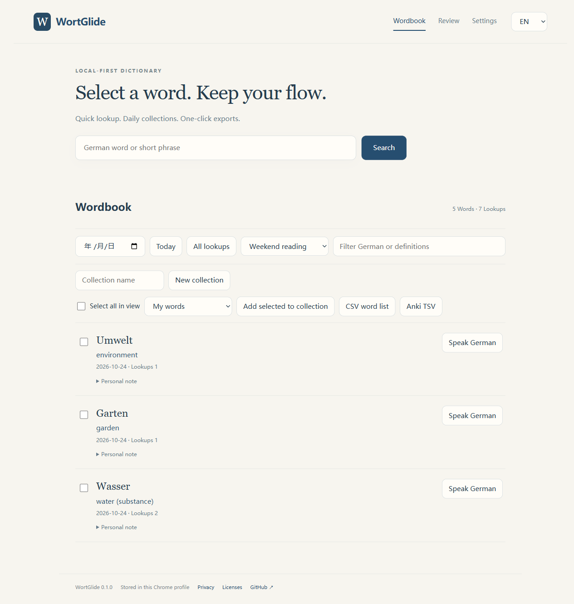

# German Learning Assistant（德语学习助手）

**Select a word. Keep your flow.**

阅读时选词查询，按天保留查词记录，按书本或课程分类收藏，再一键导出到自己的复习流程。默认英文界面，也可切换中文。

[English](README.md) · [下载](https://github.com/lizhegiballes-dot/german-learning-assistant/releases) · [隐私](PRIVACY.md) · [词库许可](THIRD_PARTY_NOTICES.md)

## 安装与使用

1. 从 Releases 下载扩展 ZIP，解压到长期保留的文件夹。
2. 打开 Chrome 扩展管理页，开启「开发者模式」，点「加载已解压的扩展程序」。
3. 选择直接包含 **manifest.json** 的那一层。如果下载的是源码，选择 **extension** 文件夹。
4. 从浏览器工具栏打开扩展，在设置中选择界面语言、释义语言，按需开启联网。安装或更新后刷新阅读页面。

不需要桌面后台、Python、账号或付费接口。目前通过 GitHub 手动安装，尚未上架商店。解压文件夹需要保留；移动文件夹可能改变扩展编号，让浏览器分配新的存储空间，因此请先导出备份。

## 日常流程

- 网页中选词后弹出词卡，也可右键查词；输入框与编辑区域不会自动触发。
- 同一规范词头合并为一条记录，累计查询次数。重试和后台补充不重复计数。
- 按本机日期查看当天查词；当天内按首次查询顺序排列。可建立「某本书」「某课程」等分类，并指定之后查到的词自动归入哪个分类。
- 收藏到生词本，写笔记，选择加入简单间隔复习。
- 勾选词条或筛选当天／分类后导出 CSV、Anki TSV。设置页可导出和合并 JSON 完整备份，重复导入不会重复增加查询次数。
- 界面语言和释义语言可以分别选择；发音使用已安装的本地德语系统声音，没有声音时会明确提示。

## 词库范围

内置 GEMET 4.2.3 的 **5,352 个德语概念**，含英文和／或中文术语标签，侧重环境及相关专业领域。另附 HanDeDict 的 **233,624 条德语到中文反向精确匹配记录**；这是匹配行数，不是不同德语词头数。反查词库有歧义，所以界面会标为「参考」，不能当作权威完整释义。

可选联网查询从英文维基词典获取德语章节中的英文释义，默认关闭。缺少中文时会明确提示，已有英文则标注后显示。不会把猜测或机器生成结果冒充词典释义。屈折变化识别、多义项覆盖和所有生僻词仍有局限。

公开版不附带杜登、朗氏的词条／录音、私人课程资料或学习记录。代码采用 MIT；词典数据分别遵循 CC BY 4.0、CC BY-SA 3.0，联网结果遵循 CC BY-SA 4.0。来源、修改说明及贡献者信息见 [许可说明](THIRD_PARTY_NOTICES.md)。

## 数据保存在哪里

数据保存在**这台电脑、当前 Chrome 用户资料、这个扩展专属的浏览器数据库**里，并不会自动在桌面建立文件，也不会自动同步到别的设备。设置页的「JSON 完整备份」会生成你可以自行保存或放进自己网盘的文件。卸载扩展会删除浏览器中的记录，请先备份。

查询事件会在本机记录阅读页面的域名与路径，去除问号后的参数和片段。路径仍可能包含个人标识，所以备份应当作为私人文件保存。联网仅发送查询词，不发送页面地址或生词本；联网服务仍能看到 IP 等普通连接信息。项目没有自建云端、遥测或广告。浏览器存储并非加密保险箱。

## 开发与反馈

开发说明、自动检查和数据重建命令见 [英文说明](README.md#build-with-us)。这是独立的公开版本，不会连接或修改原作者的私人学习工作台。欢迎提交可复现的问题和带来源的词义修正；请不要把完整学习备份上传到公开 issue。
